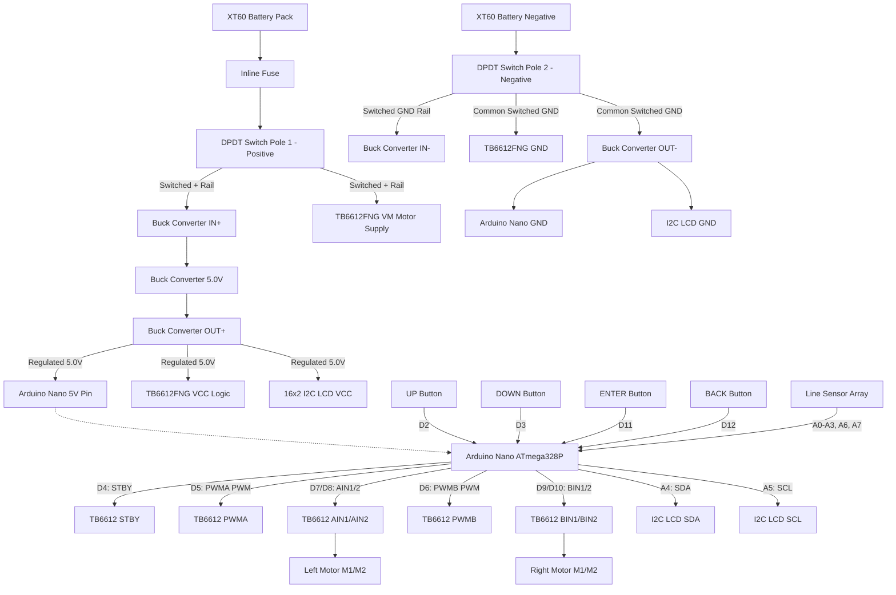

# Arduino Nano Line Follower Robot

Complete hardware wiring reference, safety protocols, pinout specifications, and firmware implementation for an **Arduino Nano (ATmega328P)** based line-follower robot with **TB6612FNG dual motor driver**, **buck converter**, **16x2 I2C LCD**, and a **4-button interactive menu system**.

---

## 📋 Table of Contents
1. [Overview & Assumptions](#overview--assumptions)
2. [System Architecture & Block Diagram](#system-architecture--block-diagram)
3. [Power Distribution](#1-power-distribution)
4. [TB6612FNG Motor Driver](#2-tb6612fng-motor-driver)
5. [I2C LCD (16x2 Backpack)](#3-i2c-lcd-assumes-16x2-lcd-with-i2c-backpack)
6. [Four Menu Push Buttons](#4-four-menu-push-buttons)
7. [Arduino Nano Pin Summary](#5-nano-pin-summary)
8. [Safety Checks Before Switching ON](#6-safety-checks-before-switching-on)
9. [Component Sizing & Details Still Needed](#7-details-still-needed)
10. [Repository Structure](#repository-structure)
11. [Software & Getting Started](#software--getting-started)

---

## Overview & Assumptions

- **Microcontroller**: Classic Arduino Nano (ATmega328P, 5V, 16 MHz).
- **Motor Driver**: Toshiba TB6612FNG dual H-bridge motor driver.
- **Display**: 16x2 Character LCD with PCF8574 I2C backpack.
- **Power**: High-current battery pack with XT60 connector stepped down to 5.0V via a switching buck converter.
- **User Interface**: 4 normally-open momentary push buttons (UP, DOWN, ENTER, BACK) using internal pull-ups (`INPUT_PULLUP`).
- **Motors**: 2 DC gear motors (Left motor and Right motor).
- **Sensors**: Analog/Digital line-sensor array (pins A0–A3, A6, A7 reserved for sensor inputs).

---

## System Architecture & Block Diagram



---

## 1. Power Distribution

XT60 battery positive (+) goes through a correctly rated fuse placed close to the battery connector, then through one pole of a Double Pole Double Throw (DPDT) switch to the switched positive rail. 

Battery negative (-) goes through the second pole of the DPDT switch to the switched GND rail.

> **Caution**: Always verify the physical switch terminals with a multimeter before soldering, as switch internal pin configurations vary by manufacturer.

### Power Routing Table

| From | To | Purpose |
| :--- | :--- | :--- |
| **XT60 battery +** | Fuse $\rightarrow$ DPDT pole 1 input | Protected positive supply |
| **DPDT pole 1 output** | Switched + rail | Feeds buck converter `IN+` and TB6612FNG `VM` |
| **XT60 battery -** | DPDT pole 2 input | Direct battery negative return |
| **DPDT pole 2 output** | Switched GND rail | Common system ground reference |
| **Switched + rail** | Buck `IN+` | Buck converter input positive |
| **Switched GND rail** | Buck `IN-` | Buck converter input negative |
| **Buck OUT+** | Nano `5V`, TB6612 `VCC`, LCD `VCC` | Regulated 5.0V clean logic supply |
| **Buck OUT-** | Nano `GND`, TB6612 `GND`, LCD `GND` | Common logic ground |
| **Switched + rail** | TB6612 `VM` | Motor drive power (only if within motor/TB6612 ratings) |

### Buck Converter Setup Notes
- **`IN+`**: Switched battery positive.
- **`IN-`**: Switched battery negative/GND.
- **`OUT+`**: Regulated 5.0V output.
- **`OUT-`**: Regulated logic ground.
- **Calibration**: Before connecting any microcontrollers or sensitive electronics, power the buck converter alone and measure voltage across `OUT+` and `OUT-` with a calibrated multimeter; turn the trimpot until it reads **precisely 5.00V**.
- **Important**: Connect `OUT+` directly to the Arduino Nano **5V pin**, **NOT VIN** (VIN requires $>6.5\text{V}$ for the onboard LDO).
- **Warning**: Never bridge or connect `IN+` directly to `OUT+` under any circumstances.

---

## 2. TB6612FNG Motor Driver

The TB6612FNG is a high-efficiency dual MOSFET H-bridge motor driver with higher efficiency and significantly less voltage drop than the legacy L298N.

### Pin Connections

| TB6612FNG Pin | Connect To | Description / Notes |
| :--- | :--- | :--- |
| **VM** | Switched battery positive rail | Motor supply voltage ($2.5\text{V} - 13.5\text{V}$) |
| **VCC** | Buck `OUT+` (Regulated 5V) | Logic supply voltage ($2.7\text{V} - 5.5\text{V}$) |
| **GND** | Common switched GND rail | System ground |
| **STBY** | Arduino Nano **D4** | Standby control (HIGH = Active, LOW = Motors disabled) |
| **PWMA** | Arduino Nano **D5** (PWM) | Left motor speed control ($0 - 255$) |
| **AIN1** | Arduino Nano **D7** | Left motor direction input 1 |
| **AIN2** | Arduino Nano **D8** | Left motor direction input 2 |
| **AO1 / AO2** | Left Motor Terminals 1 / 2 | Left motor H-bridge output |
| **PWMB** | Arduino Nano **D6** (PWM) | Right motor speed control ($0 - 255$) |
| **BIN1** | Arduino Nano **D9** | Right motor direction input 1 |
| **BIN2** | Arduino Nano **D10** | Right motor direction input 2 |
| **BO1 / BO2** | Right Motor Terminals 1 / 2 | Right motor H-bridge output |

> **Direction Note**: If a motor spins opposite to its intended forward direction, either swap that motor's two physical output wires (`AO1`/`AO2` or `BO1`/`BO2`) or invert the direction logic in software.  
> **Warning**: **Never power motors from the Arduino Nano 5V pin.**

---

## 3. I2C LCD (Assumes 16x2 LCD with I2C Backpack)

Uses a standard HD44780 16x2 LCD module coupled with a PCF8574 I2C adapter, consuming only the two dedicated hardware I2C pins on the ATmega328P.

| LCD Pin | Arduino Nano Pin | Notes |
| :--- | :--- | :--- |
| **GND** | **GND** | Common ground reference |
| **VCC** | **5V** (from Buck `OUT+`) | Regulated 5.0V power |
| **SDA** | **A4** (SDA) | Hardware I2C Serial Data |
| **SCL** | **A5** (SCL) | Hardware I2C Serial Clock |

- Default I2C address is commonly `0x27` or `0x3F`.

---

## 4. Four Menu Push Buttons

Connect one terminal of each normally-open momentary tactile push button to its dedicated Nano GPIO pin and the other terminal directly to ground (`GND`).

Internal pull-ups are enabled via `pinMode(pin, INPUT_PULLUP)`. When unpressed, the pin reads `HIGH`; when pressed, it connects to ground and reads `LOW`. No external pull-up resistors are required.

> **Tip for 4-pin Tactile Switches**: Connect across diagonally opposite legs or use opposite sides of the switch body to ensure you are switching across the internal open contact rather than shorting internally bridged legs.

| Button | Arduino Nano Pin | Other Terminal | Setup Code |
| :--- | :--- | :--- | :--- |
| **UP** | **D2** | `GND` | `pinMode(2, INPUT_PULLUP);` |
| **DOWN** | **D3** | `GND` | `pinMode(3, INPUT_PULLUP);` |
| **ENTER** | **D11** | `GND` | `pinMode(11, INPUT_PULLUP);` |
| **BACK** | **D12** | `GND` | `pinMode(12, INPUT_PULLUP);` |

```cpp
void setupButtons() {
    pinMode(2, INPUT_PULLUP);  // UP
    pinMode(3, INPUT_PULLUP);  // DOWN
    pinMode(11, INPUT_PULLUP); // ENTER
    pinMode(12, INPUT_PULLUP); // BACK
}
```

---

## 5. Nano Pin Summary

Comprehensive overview of all 30 pins on the Arduino Nano ATmega328P board:

| Nano Pin | Hardware Function | System Assignment | Notes |
| :--- | :--- | :--- | :--- |
| **D0 / RX** | UART Receive | Hardware Serial / USB | Reserved for code upload & debugging |
| **D1 / TX** | UART Transmit | Hardware Serial / USB | Reserved for code upload & debugging |
| **D2** | Digital / INT0 | **UP Button** | Internal pull-up (`INPUT_PULLUP`) |
| **D3** | Digital / INT1 / PWM | **DOWN Button** | Internal pull-up (`INPUT_PULLUP`) |
| **D4** | Digital GPIO | **TB6612 STBY** | Standby control pin |
| **D5** | Timer0 PWM | **TB6612 PWMA** | Left motor speed control ($980\text{ Hz}$) |
| **D6** | Timer0 PWM | **TB6612 PWMB** | Right motor speed control ($980\text{ Hz}$) |
| **D7** | Digital GPIO | **TB6612 AIN1** | Left motor direction 1 |
| **D8** | Digital GPIO | **TB6612 AIN2** | Left motor direction 2 |
| **D9** | Timer1 PWM | **TB6612 BIN1** | Right motor direction 1 |
| **D10** | Timer1 PWM / SPI SS | **TB6612 BIN2** | Right motor direction 2 |
| **D11** | SPI MOSI | **ENTER Button** | Internal pull-up (`INPUT_PULLUP`) |
| **D12** | SPI MISO | **BACK Button** | Internal pull-up (`INPUT_PULLUP`) |
| **D13** | SPI SCK / Builtin LED | Status LED | Built-in test LED |
| **A4** | ADC4 / I2C SDA | **LCD SDA** | I2C Data bus |
| **A5** | ADC5 / I2C SCL | **LCD SCL** | I2C Clock bus |
| **A0 - A3** | Analog ADC0 - ADC3 | **Line Sensor Inputs** | Configurable for IR analog/digital line arrays |
| **A6, A7** | Analog-only Inputs | **Additional Sensor Inputs** | Analog-only pins (ATmega328P TQFP32) |
| **5V** | Power Pin | **Buck OUT+ Input** | Regulated +5.0V power input from buck converter |
| **VIN** | Power Pin | *Unused* | **Do NOT connect** when 5V pin is powered |
| **GND** | Ground | **Common Switched GND** | Tied to common ground rail |

---

## 6. Safety Checks Before Switching ON

Perform every step in this checklist **before** connecting the battery:

1. **Multimeter Polarity Verification**:
   - Check the XT60 connector polarity with a multimeter before plugging in the battery. Red is positive, Black is negative.
2. **Voltage Range Verification**:
   - Confirm your battery pack voltage falls safely within the input rating of your buck converter and the maximum ratings of the TB6612FNG ($VM \le 15\text{V}$, recommended $\le 12\text{V}$) and your DC motors.
3. **Buck Converter Output Pre-tuning**:
   - Disconnect the Nano 5V pin, TB6612 VCC, and LCD VCC.
   - Power the buck converter alone.
   - Measure `OUT+` to `OUT-` with your multimeter.
   - Adjust the trimpot until the output reads **exactly 5.00V**.
4. **Short-Circuit Inspection**:
   - With the battery disconnected, switch the DPDT switch to ON.
   - Probe resistance between the switched positive rail and common GND rail using the multimeter's continuity/resistance mode. Ensure there are **no short circuits** (no zero-ohm reading).
5. **Common Ground Verification**:
   - Confirm that Nano GND, Buck `OUT-`, TB6612 GND, LCD GND, and sensor GND all have $0\,\Omega$ continuity to the switched negative rail.
6. **Motor Supply Isolation**:
   - Verify that motor drive power originates from TB6612 `VM` (fed by the switched battery rail) and motor outputs `AO1`/`AO2`/`BO1`/`BO2`, **never from the Nano 5V pin**.
7. **Fuse & Current Sizing**:
   - Check that the fuse rating matches your expected total peak stall current of both motors plus logic draw with safe thermal margin.
8. **Initial Powered Test**:
   - Place the robot on a stand with **wheels lifted off the ground** before flicking the DPDT switch ON for the first time.

---

## 7. Details Still Needed

When adapting this project for your specific competition or robot build, finalize the following:

- **Line-Sensor Wiring**:
  - The pinout reserves **A0–A3, A6, and A7** for sensor inputs. Pin assignments depend on your sensor module:
    - 5-channel digital array (e.g., TCRT5000, QTR-5RC)
    - 6-channel or 8-channel analog reflectance array (e.g., Pololu QTR-8A)
    - I2C sensor array
- **Battery & Motor Sizing**:
  - Specify battery nominal voltage (e.g., 2S 7.4V LiPo or 3S 11.1V LiPo).
  - Verify motor rated voltage and stall current to select the correct fuse amperage (e.g., $3\text{A} - 5\text{A}$ fast-acting fuse).
  - Check continuous current limit of TB6612FNG ($1.2\text{A}$ per channel continuous, $3.2\text{A}$ peak).
- **Ground Rule**:
  - Nano GND, buck `OUT-`, TB6612 GND, LCD GND, and sensor GND **must share the same ground reference**. With the DPDT switch isolating both battery rails, all module grounds must connect to the switched negative/GND rail.

---

## Repository Structure

```
.
├── README.md                      # Complete reference & project guide
├── WIRING_GUIDE.md                # Comprehensive terminal-by-terminal wiring instructions
├── SCHEMATIC.md                   # Full schematic diagrams and pin interconnection tables
├── .gitignore                     # Git ignore rules for Arduino/PlatformIO/VSCode
└── src/
    ├── LineFollower_Main.ino      # Complete production Arduino sketch
    └── config.h                   # Pin definitions and robot configuration constants
```

---

## Software & Getting Started

### Prerequisites
- [Arduino IDE](https://www.arduino.cc/en/software) (version 1.8.x or 2.x)
- Required Libraries:
  - `LiquidCrystal_I2C` (by Frank de Brabander)
  - `Wire` (built-in AVR I2C library)

### Upload Instructions
1. Open `src/LineFollower_Main.ino` in the Arduino IDE.
2. Select **Tools $\rightarrow$ Board $\rightarrow$ Arduino AVR Boards $\rightarrow$ Arduino Nano**.
3. Select **Tools $\rightarrow$ Processor $\rightarrow$ ATmega328P** (or *ATmega328P (Old Bootloader)* depending on your Nano clone).
4. Select the corresponding COM port.
5. Compile and upload the sketch!
