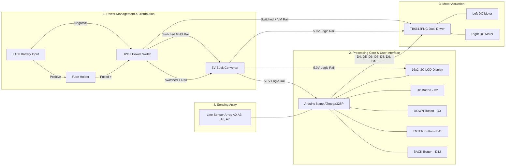

# Hardware Schematics & Interconnection Diagram

Detailed schematic representations and circuit layouts for the Arduino Nano Line Follower robot.

---

## 1. Schematic Flowchart



---

## 2. ASCII Pinout Interconnection Diagram

```
                 ===========================================================
                                     ARDUINO NANO PINOUT
                 ===========================================================
                                        +-----+
                           (TXD)  D1/TX |     | VIN
                           (RXD)  D0/RX |     | GND   <-- COMMON SWITCHED GND
                                  RESET |     | RESET
                                    GND |     | 5V    <-- +5.0V FROM BUCK OUT+
      [BTN UP]      <--- INPUT --    D2 |     | A7    <-- SENSOR CH6 / ANALOG IN
      [BTN DOWN]    <--- INPUT --    D3 |     | A6    <-- SENSOR CH5 / ANALOG IN
      [TB6612 STBY] <--- OUTPUT -    D4 |     | A5    <-- LCD I2C SCL
      [TB6612 PWMA] <--- PWM ----    D5 |     | A4    <-- LCD I2C SDA
      [TB6612 PWMB] <--- PWM ----    D6 |     | A3    <-- SENSOR CH4
      [TB6612 AIN1] <--- OUTPUT -    D7 |     | A2    <-- SENSOR CH3
      [TB6612 AIN2] <--- OUTPUT -    D8 |     | A1    <-- SENSOR CH2
      [TB6612 BIN1] <--- OUTPUT -    D9 |     | A0    <-- SENSOR CH1
      [TB6612 BIN2] <--- OUTPUT -   D10 |     | AREF
      [BTN ENTER]   <--- INPUT --   D11 |     | 3V3
      [BTN BACK]    <--- INPUT --   D12 |     | D13   <-- LED BUILTIN
                                        +-----+

                 ===========================================================
                                  TB6612FNG MOTOR DRIVER
                 ===========================================================
                                        +-----+
             Switched Battery (+) --->  | VM  |  AO1  ---> Left Motor (+)
             Buck OUT+ (5.0V)     --->  | VCC |  AO2  ---> Left Motor (-)
             Common Switched GND  --->  | GND |  BO2  ---> Right Motor (-)
             Nano D5 (PWMA)       --->  |PWMA |  BO1  ---> Right Motor (+)
             Nano D7 (AIN1)       --->  |AIN1 |  GND  ---> Common Switched GND
             Nano D8 (AIN2)       --->  |AIN2 |  GND  ---> Common Switched GND
             Nano D4 (STBY)       --->  |STBY |  BIN2 <--- Nano D10 (BIN2)
             Nano D9 (BIN1)       --->  |BIN1 |  BIN1 <--- Nano D9 (BIN1)
             Nano D6 (PWMB)       --->  |PWMB |
                                        +-----+
```

---

## 3. Power Distribution Diagram

```
   [ XT60 (+) ] ---> [ FUSE (3A-5A) ] ---> [ DPDT Sw Pole 1 ] ---> Switched + Rail (Motor VM & Buck IN+)
   
   [ XT60 (-) ] -------------------------> [ DPDT Sw Pole 2 ] ---> Switched GND Rail (Common Ground)

                      +--------------------+
   Switched + Rail -> | IN+            OUT+| -> +5.00V Regulated Bus (Nano 5V, TB6612 VCC, LCD VCC)
                      |   BUCK CONVERTER   |
   Switched GND    -> | IN-            OUT-| -> Common Ground Bus (Nano GND, TB6612 GND, LCD GND)
                      +--------------------+
```
